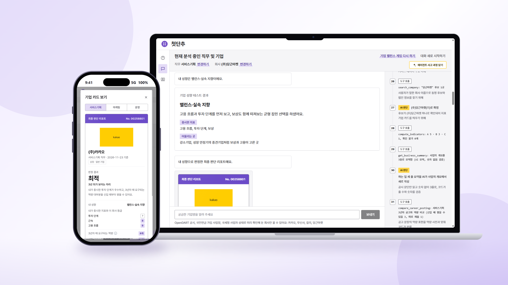
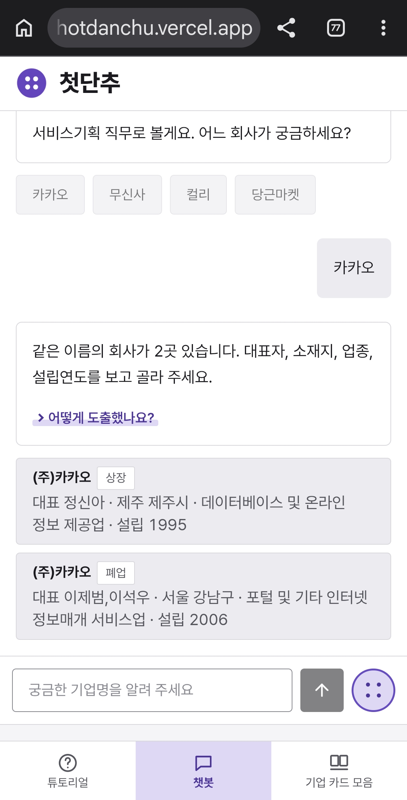
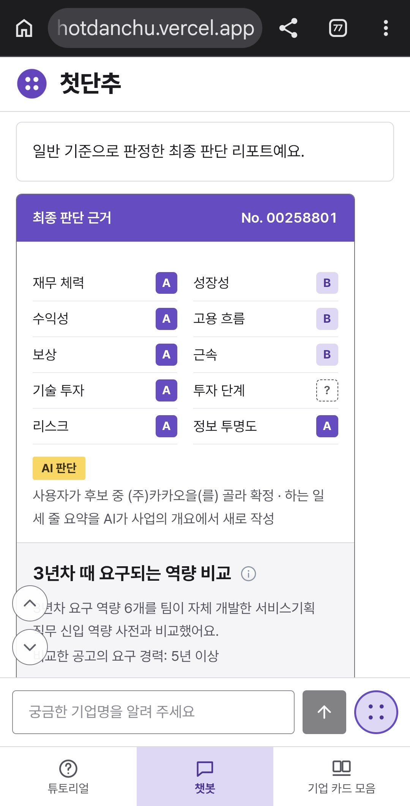
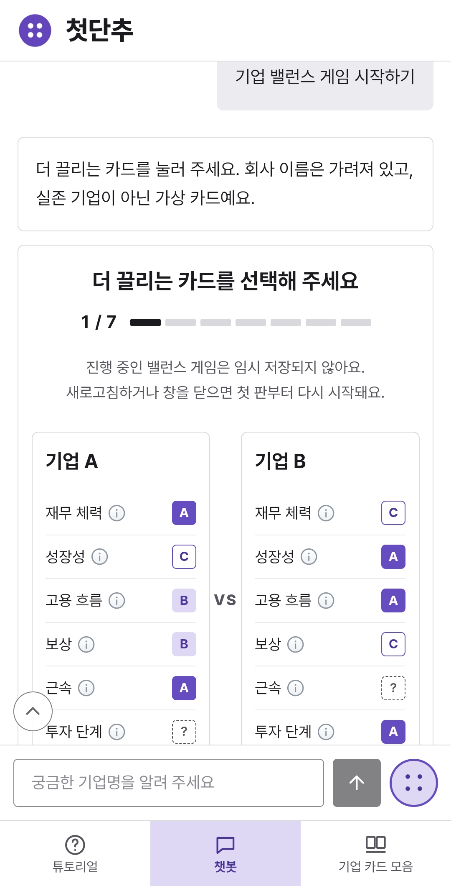
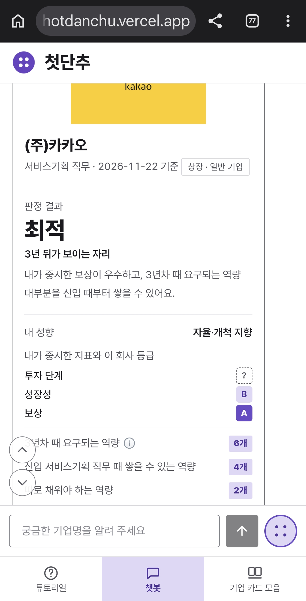
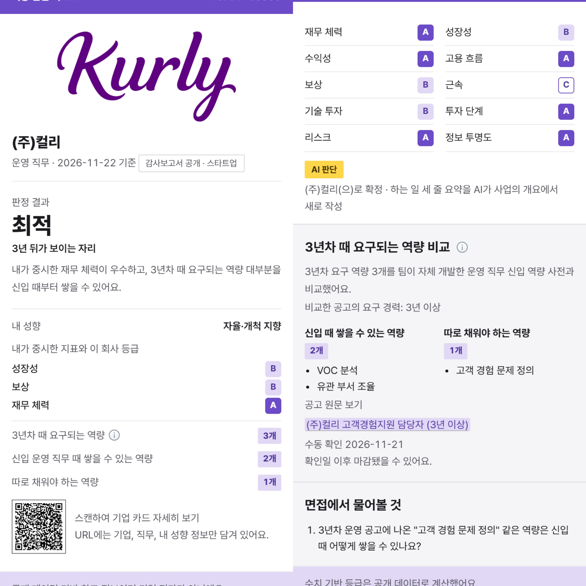
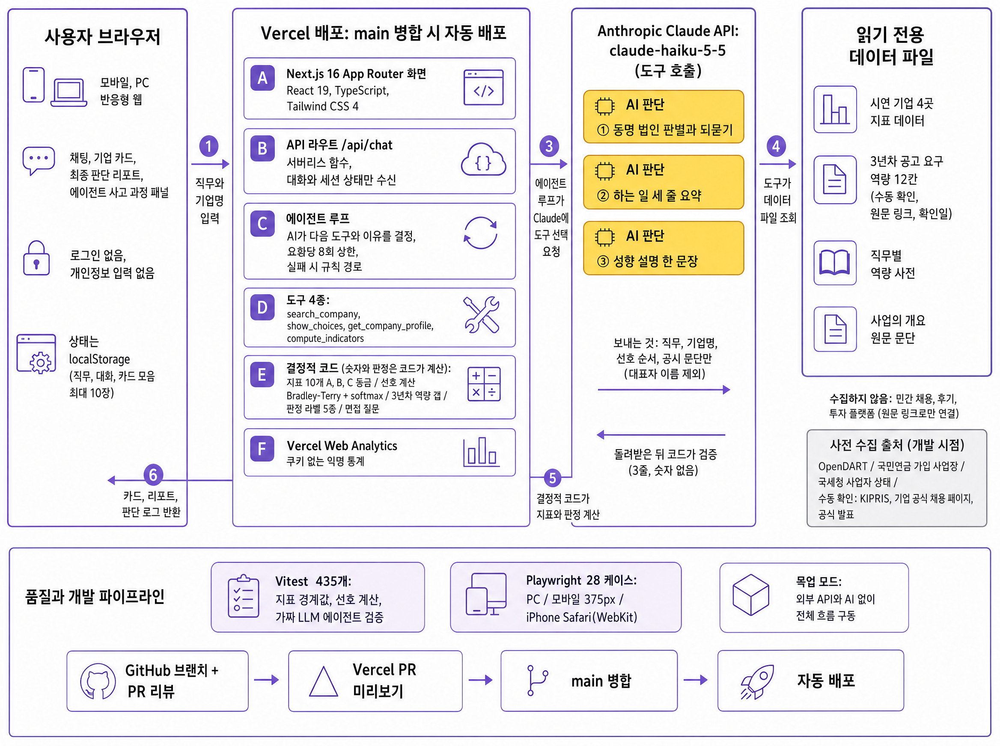

<div align="center">


# 첫단추

**첫 회사, 3년 뒤까지 보고 고르세요.**

직무와 기업명만 말하면, AI 에이전트가 공공데이터와 같은 직무 3년차 공고로<br>그 회사가 **첫 커리어 발판으로 맞는지** 판단해 주는 서비스입니다.

[라이브 데모](https://chotdanchu.vercel.app) · [시연 영상](#시연-영상) · [개발 설명 자료](https://msdigita1p0et.notion.site/420991804aa78191b218facf2cbecebf) · [디자인 스타일 타일](design/styletile/index.html)


<a href="https://chotdanchu.vercel.app"></a><br>
<sub>휴대폰으로 스캔해서 바로 써 보세요</sub>

</div>

<p align="center"></p>

## 한눈에 보기

- **로그인과 이력서 없이** 직무와 기업명만 입력합니다.
- 기업 지표 10가지를 **공식 출처**로 계산하고, 근거가 없으면 `확인 불가`로 표시합니다.
- 같은 직무 **3년차 공고**와 비교해 신입 때 쌓을 수 있는 역량과 따로 채워야 할 역량을 나눕니다.
- 회사명을 가린 **밸런스 게임** 7판으로 내 성향을 알아내 판정에 반영합니다.
- **숫자와 판정은 코드가 계산**하고, AI는 법인 판별과 짧은 문장만 맡습니다.

## 왜 만들었나

졸업 예정자나 공백기가 있는 신입 지원자에게 첫 회사는 앞으로 3년이 걸린 결정입니다. 채용 플랫폼은 합격 가능성만 알려 주고, 입사 후 모습은 공시, 국민연금, 후기 사이트를 오가며 직접 가늠해야 하며 비상장 기업은 정보가 더 부족합니다.

| 기존 방식 | 첫단추 |
|---|---|
| "합격 가능성 73%" | "이 자리에서 3년 뒤 어디로 이어지는가" |
| 공시, 국민연금, 후기 사이트를 직접 오가며 조사 | 기업명 한 번 입력 |
| 정보가 없으면 빈칸 | 근거 없는 지표는 `확인 불가`로 명시하고 면접 역질문으로 전환 |
| 모두에게 같은 정보 | 밸런스 게임으로 파악한 내 선호에 맞춘 판정 |

**대상 사용자**: 아직 첫 회사를 고르지 않은 신입 취업 준비생. 이미 입사한 중고신입이 아니라, 지금 첫 회사를 고르는 사람입니다.

## 시연 영상

> **[링크 자리] 시연 영상** (유튜브 링크)

## 사용 흐름

```
직무 선택 → 기업명 입력 → 동명 법인 확인 → 기업 지표 카드 → 밸런스 게임 → 최종 판단 리포트
```

| 1. 법인 확인 | 2. 지표 카드 | 3. 밸런스 게임 | 4. 최종 판단 리포트 |
|:---:|:---:|:---:|:---:|
|  |  |  |  |
| 같은 이름의 법인 2곳을 가려 되묻습니다 | 10가지 지표와 하는 일 세 줄 요약 | 가려진 카드 7판으로 내 기준을 찾습니다 | 판정, 3년차 역량 비교, 면접 질문 |


## 주요 기능

| 기능 | 설명 |
|---|---|
| **법인 확인** | 이름이 같은 회사는 업종, 소재지, 설립연도로 후보를 보여 주고 사용자에게 되묻습니다. 상장, 폐업 여부도 함께 보여 줍니다. |
| **기업 지표 카드** | 기업 유형(상장, 감사보고서 공개, 비공시)에 맞는 기준표로 10가지 지표를 A, B, C, `확인 불가`로 보여 줍니다. 값마다 출처와 기준일이 붙습니다. |
| **하는 일 세 줄 요약** | OpenDART 사업보고서의 "사업의 개요"를 AI가 숫자 없이 3줄로 요약합니다. 코드가 줄 수와 숫자 여부를 검증하고, 어기면 미리 만든 요약을 씁니다. |
| **3년차 역량 갭** | 3년차 공고의 요구 역량을 **신입 때 쌓을 수 있는 역량**과 **따로 채워야 하는 역량**으로 나눕니다. 이력서나 경력은 받지 않습니다. |
| **기업 밸런스 게임** | 회사명을 가린 가상 카드 8장으로 7판 토너먼트를 합니다. 지표 10개의 중요도를 계산하고 성향을 한 문장으로 설명합니다. 건너뛸 수 있습니다. |
| **최종 판단 리포트** | 지표, 선호, 역량 갭을 엮어 판정 라벨과 면접 질문을 줍니다. 앞면은 결론, 뒷면은 근거입니다. 이미지와 QR로 저장하고 공유합니다. |
| **에이전트 사고 과정** | 에이전트가 어떤 도구를 왜 불렀는지, AI가 정한 곳과 코드가 계산한 곳이 화면에 남습니다. |
| **기업 카드 모음** | 리포트를 기업별 카드로 모읍니다(최대 10장). 로그인 없이 브라우저에만 저장됩니다. |

<p align="center"></p>

## 판정 라벨

두 숫자를 코드가 계산해 정합니다. 숫자가 아닌 문장(이유 한 줄)은 규칙 문장이고, 회사를 평가하는 표현은 쓰지 않습니다.

- **이어짐**: 3년차 요구 역량 중 신입 때 쌓을 수 있는 비율 (기준 0.6)
- **기반**: 내 선호 가중치로 낸 지표 등급 평균, A 1, B 0.5, C 0, `확인 불가` 제외 (기준 0.75)

| 라벨 | 조건 | 뜻 |
|---|---|---|
| 최적 | 이어짐 높음, 기반 좋음 | 3년 뒤가 보이는 자리 |
| 도전 | 이어짐 높음, 기반 약함 | 배울 건 많지만 감수할 게 있는 자리 |
| 안정 | 이어짐 낮음, 기반 좋음 | 든든하지만 일부 역량은 따로 채우기 |
| 고려 | 이어짐 낮음, 기반 약함 | 다른 선택지와 비교해 볼 자리 |
| 정보 보강 | 정보 투명도 C 또는 3년차 공고 없음 | 면접에서 더 알아볼 자리 |
| 판단 필요 | 밸런스 게임을 건너뜀(일반 기준) | 내 기준을 알려 주면 판정해 드려요 |

같은 성향 유형이어도 판정은 유형이 아니라 **지표 10개의 가중치 전부**로 계산해서, 재무 체력을 중시한 사람과 근속을 중시한 사람의 결과가 달라질 수 있습니다.

## 10가지 지표

| 지표 | 보는 것 |
|---|---|
| 재무 체력 | 빚 부담과 버틸 힘. 일반 기업은 부채비율, 스타트업은 현금으로 몇 개월 버티는지 |
| 성장성 | 매출이 1년 전보다 얼마나 늘었는지 |
| 수익성 | 본업으로 이익을 내는지(영업이익률) |
| 고용 흐름 | 1년 전보다 직원이 늘었는지, 얼마나 많이 퇴사하는지 |
| 보상 | 국민연금 신고 금액으로 추정한 보상 수준 (`추정` 표시) |
| 근속 | 직원들이 평균 몇 년 다니는지 |
| 기술 투자 | 연구개발 비중이나 등록 특허 수 |
| 투자 단계 | 외부 투자를 어느 단계까지 받았는지 (스타트업만) |
| 리스크 | 휴업, 폐업, 감사의견 같은 위험 신호 |
| 정보 투명도 | 나머지 지표 중 공식 출처로 확인된 비율 |

등급 기준은 팀이 공개 자료와 실측으로 정한 자체 기준이며, 일반 기업과 스타트업은 기준표를 따로 씁니다. 자세한 정의와 출처는 [`docs/indicators.md`](docs/indicators.md)를 봅니다.

## AI와 코드의 역할

**원칙: 숫자와 판정은 코드가 만들고, AI는 판단이 필요한 세 곳에서만 씁니다.** 같은 입력이면 같은 숫자와 같은 결과가 나옵니다.

| AI가 하는 일 (claude-haiku-5-5 한 모델) | 안전장치 |
|---|---|
| **기업 특정**: 입력이 어느 법인인지, 되물을지 정함. 도구 4개 중 다음에 부를 도구를 스스로 고름 | 요청당 도구 호출 8회 상한, 검색 결과가 없으면 코드가 안내 |
| **하는 일 세 줄 요약**: 공시 원문을 읽고 요약 | 코드가 3줄, 줄 길이, 숫자 없음 검증, 실패하면 미리 만든 요약 |
| **성향 설명 한 문장**: 중시 지표 순서만 보고 풀어 설명 | 숫자나 줄표가 있으면 버리고 규칙 문장 사용 |

AI가 하지 않는 일: 모든 수치, 등급, 역량 갭 분류, 선호 가중치 계산, 판정 라벨, 면접 질문. AI 호출이 실패하면 정해진 규칙 경로로 대신 답하고 그 사실을 사고 과정에 남깁니다. 에이전트 설계의 자세한 내용은 [`docs/agent-design.md`](docs/agent-design.md)에 있습니다.

## 아키텍처

<p align="center"></p>

- 브라우저 상태(직무, 대화, 카드 모음)는 localStorage에만 두고, 서버는 상태를 갖지 않습니다.
- 실행 중에는 외부 데이터 API를 부르지 않습니다. 시연 기업 4곳(카카오, 무신사, 컬리, 당근마켓)은 OpenDART, 국민연금, 국세청 데이터를 사전에 계산해 `data/real/`에 두고 읽습니다. 목록에 없는 회사는 "아직 준비되지 않은 회사"로 안내합니다.
- 비밀 키는 저장소가 아니라 Vercel 환경 변수에만 있습니다.

## 기술 스택

| 영역 | 선택 |
|---|---|
| 프레임워크 | Next.js 16 (App Router), React 19, TypeScript |
| 스타일 | Tailwind CSS 4, CSS 변수 디자인 토큰 |
| AI | Anthropic Claude API 도구 호출(tool use), `claude-haiku-5-5` |
| 테스트 | Vitest (단위, 통합), Playwright (화면 흐름, 아이폰 사파리 엔진 WebKit 포함) |
| 배포와 통계 | Vercel, Vercel Web Analytics (쿠키 없는 익명 통계) |
| 기타 | html-to-image (카드 이미지 저장), qrcode.react (QR) |

외부 라이브러리와 데이터의 출처와 라이선스는 [`docs/data-sources.md`](docs/data-sources.md)에 기록합니다.

## 테스트

| 계층 | 내용 | 규모 |
|---|---|---|
| 단위, 통합 (Vitest) | 지표 경계값, 선호 계산의 결정성, 역량 갭, 판정 라벨, 가짜 LLM으로 에이전트 루프(도구 호출 순서, 8회 상한, 오류와 거절, 개인정보 미전송) | 437개 |
| 기준표 연결 검사 | 등급 기준표의 모든 행이 경계값 테스트와 연결되어 있어, 기준을 추가하고 테스트를 빼면 자동 검사가 실패 | 자동 |
| 화면 흐름 (Playwright) | 첫 방문, 직무, 기업, 후보, 카드, 밸런스 게임, 리포트, 카드 모음 흐름을 PC, 모바일 375px, 아이폰 사파리 엔진에서 실행 | 28 케이스 |

설계 기법은 동등 분할, 경계값 분석, 상태 전이, 오류 추정이며 케이스 추적표는 [`docs/testing.md`](docs/testing.md)에 있습니다. 실제 아이폰과 카카오톡 앱 안 브라우저의 갤러리 저장은 자동으로 확인하지 못했습니다.

## 데이터와 개인정보

- **공공 데이터**: OpenDART(금융감독원 전자공시), 국민연금공단 가입 사업장 내역, 국세청 사업자 상태 조회
- **수동 확인**: 특허청 KIPRIS 등록 특허, 기업 공식 채용 페이지의 3년차 공고, 기업과 투자사의 공식 발표. 값마다 원문 링크, 확인 날짜, `수동 확인` 표시를 붙입니다.
- **수집하지 않음**: 민간 채용, 후기, 투자 데이터 플랫폼. 필요하면 원문 링크로만 연결합니다.
- **개인정보**: 이력서, 포트폴리오, 연락처를 받지 않고 로그인도 없습니다. AI에는 직무, 기업명, 선호 순서, 공시 문단만 보내며 대표자 이름은 보내지 않습니다.

## 디자인 시스템

스타일 타일에서 색, 글자 크기, 부품을 먼저 정하고 `app/globals.css` 한 곳에 옮겼습니다.

- [스타일 타일 `design/styletile/index.html`](design/styletile/index.html): 색, 글자 크기, 버튼, 카드, 배지 부품을 한 장에 모은 HTML 파일입니다. 저장소를 받아 브라우저로 열면 렌더링된 화면을 볼 수 있습니다.
- [화면 시안 v3](design/v3/index.html) · [로고 후보](design/logo-candidates)

| 항목 | 규칙 |
|---|---|
| 색 | 주색 보라 `#6B4BC8`(주 버튼, 등급 배지, 카드 윗띠), 연보라 `#E1D8F6`(선택 상태), 노랑은 "AI 판단" 표시에만 |
| 글꼴 | Pretendard |
| 글자 크기 | 읽는 글 16px, 카드 안 정보 14px, 배지 최소 12px |
| 모양 | 1px 회색 선, 모서리 2~6px, 그림자 없음, 라이트 모드만 |

## 로컬에서 실행하기

Node.js(LTS)가 필요합니다.

```bash
npm install
cp .env.example .env.local
npm run dev
```

http://localhost:3000 을 엽니다. 기본은 목업 모드(`USE_MOCK=true`)라 API 키 없이 처음부터 끝까지 동작합니다.

| 환경 변수 | 설명 |
|---|---|
| `USE_MOCK` | `true`면 외부 데이터 API 없이 `data/mock/`의 가상 데이터로 동작 |
| `USE_AGENT` | `true`면 Claude API로 에이전트 루프를 실행(크레딧 사용). 꺼 두면 정해진 규칙으로 답함 |
| `ANTHROPIC_API_KEY` | 에이전트를 켤 때만 필요 |
| `OPENDART_API_KEY`, `DATA_GO_KR_API_KEY` | 사전 계산 스크립트(`scripts/`)에서만 사용, 서버에는 넣지 않음 |

```bash
npm test            # 단위, 통합 테스트
npm run test:e2e    # 화면 흐름 테스트 (처음 한 번 npx playwright install)
npm run build       # 프로덕션 빌드
```

## 폴더 구조

```
chotdanchu/
├─ app/            화면(page.tsx)과 API(api/chat)
├─ components/     화면 요소
├─ lib/            지표 계산, 선호 계산, 판정 라벨, 에이전트 루프, 데이터 로더
├─ data/
│  ├─ real/        시연 기업 4곳의 사전 계산 데이터
│  ├─ mock/        개발용 가상 데이터
│  ├─ competencies/  직무별 역량 사전
│  └─ matchup/     밸런스 게임 가상 카드
├─ scripts/        사전 계산 스크립트
├─ tests/          unit(Vitest), e2e(Playwright)
├─ design/         스타일 타일, 화면 시안, 로고 후보
└─ docs/           설계 문서 (아래 목록)
```

## 한계와 로드맵

| 항목 | 현재 버전 | 확장 계획 |
|---|---|---|
| 직무 | 서비스기획, 마케팅, 운영 3개 | 직무별 역량 사전과 3년차 공고를 추가하면 늘어남 |
| 기업 정보 | 시연 기업 4곳을 사전 계산 | 공공데이터를 실시간 조회하고 DB에 캐시 |
| 3년차 공고 | 회사 공식 채용 페이지를 사람이 확인한 12칸 | 공공 채용 API 또는 공식 채용 데이터 제휴 |
| 사용자 상태 | 로그인 없이 브라우저 localStorage | 계정과 DB |

- 역량 사전은 신입 공고와 3년차 공고를 따로 모은 것이 아니라, 초안을 공고 몇 건으로 검수한 것입니다. 3년차 예상 역량 10개 중 시연 기업 공고에 실제로 나온 것은 3개였습니다.
- 카카오의 마케팅, 운영 직무는 같은 회사 공고가 없어 무신사, 컬리 공고로 대체하고 화면에 사유를 표시합니다.
- 이후 과제: 유사 기업 대체를 AI가 고르고 코드가 검증, 리포트 후 후속 질문 도구, 직무가 불명확할 때 되묻기, 다크 모드.

## 문서

| 문서 | 내용 |
|---|---|
| [`docs/agent-design.md`](docs/agent-design.md) | 에이전트 구현 방식, 도구 목록 |
| [`docs/indicators.md`](docs/indicators.md) | 10가지 지표 정의와 출처 |
| [`docs/schema.md`](docs/schema.md) | 데이터 구조 |
| [`docs/testing.md`](docs/testing.md) | 테스트 설계와 케이스 추적표 |
| [`docs/data-sources.md`](docs/data-sources.md) | 외부 데이터, API, 라이브러리 출처표 |
| [`docs/dev-notes.md`](docs/dev-notes.md) | 기획 결정과 구현 상세 기록 |
| [`docs/workflow.md`](docs/workflow.md) | 브랜치, 커밋, PR 협업 규칙 |

## 팀

**팀 연동**

| 이름 | 역할 |
|---|---|
| 윤동주 | 기획, 에이전트 루프, 데이터 연동, 테스트 설계와 QA, 코드 리뷰 |
| 연준오 | 개발, UI 디자인, 데이터 수집과 분석 |

2026 대한민국 청년 CAREER FAIR AI 해커톤(대한상공회의소) 출품작입니다.
